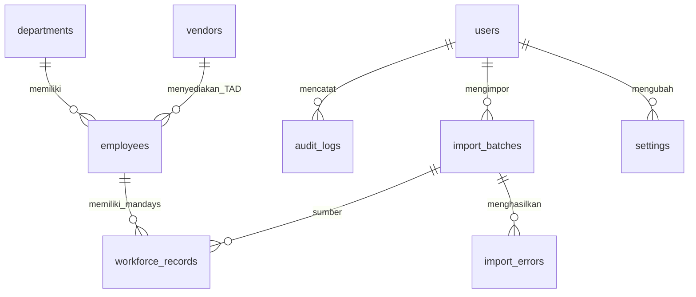

# Smart Workforce Analytics

**Smart Workforce Analytics** adalah aplikasi sistem informasi berbasis web untuk mengelola, memantau, menganalisis, dan melaporkan data tenaga kerja secara terpusat. Aplikasi ini mencakup pengelolaan karyawan, Tenaga Alih Daya (TAD), peserta magang, vendor, serta data mandays.

Proyek ini dikembangkan menggunakan **PHP Native dan MySQL** tanpa framework PHP, dengan fokus pada pengelolaan data tenaga kerja, visualisasi informasi, validasi data, pelaporan, serta pengaturan hak akses pengguna.

> **Status pengembangan:** Tahap 7 dari 7 — Final  
> **Data demo:** Seluruh data pada repository ini merupakan data sintetis/fiktif.

---

## Daftar Isi

- [Fitur Utama](#fitur-utama)
- [Teknologi](#teknologi)
- [Hak Akses Pengguna](#hak-akses-pengguna)
- [Persyaratan Sistem](#persyaratan-sistem)
- [Instalasi](#instalasi)
- [Akun Demo](#akun-demo)
- [Panduan Import Excel](#panduan-import-excel)
- [Report Center](#report-center)
- [Keamanan](#keamanan)
- [Aturan dan Perhitungan Data](#aturan-dan-perhitungan-data)
- [Struktur dan Relasi Database](#struktur-dan-relasi-database)
- [Keterbatasan](#keterbatasan)
- [Catatan](#catatan)

---

## Fitur Utama

| Modul | Deskripsi |
|---|---|
| **Dashboard** | Menampilkan 7 KPI, 4 grafik, ringkasan kualitas data, serta tabel rekap per vendor. Dilengkapi filter periode dan departemen. |
| **Data Tenaga Kerja** | Mengelola data karyawan, TAD, dan peserta magang melalui fitur tambah, lihat, ubah, hapus, pencarian, filter, sorting, dan pagination. |
| **Departemen** | Mengelola data departemen yang terhubung dengan data tenaga kerja. |
| **Vendor** | Mengelola data vendor, rekap TAD per vendor, dan pemantauan masa kontrak. |
| **Mandays & Kehadiran** | Mengelola catatan mandays bulanan serta rekap berdasarkan periode, departemen, dan vendor. |
| **Analytics** | Menyediakan analisis tren, perbandingan antarperiode, 6 grafik, dan ringkasan perubahan data. |
| **Smart Excel Import** | Mengimpor data tenaga kerja dan mandays dari file `.xlsx` atau `.csv`, dilengkapi pemetaan kolom, pratinjau, validasi, dan deteksi duplikat. |
| **Data Quality** | Menjalankan 14 pemeriksaan kualitas data, menampilkan skor kelengkapan, serta mengidentifikasi record yang bermasalah. |
| **Riwayat Import** | Menampilkan riwayat proses import beserta ringkasan dan kesalahan yang ditemukan. |
| **Report Center** | Menyediakan 6 jenis laporan dengan pratinjau serta ekspor ke Excel dan PDF. |
| **User Management** | Mengelola akun pengguna, role, status akun, reset password, dan penguncian akun. |
| **Activity Logs** | Mencatat aktivitas pengguna dan menyediakan filter serta ekspor riwayat aktivitas. |
| **Pengaturan** | Mengatur masa peringatan kontrak vendor, ukuran maksimum file import, dan jumlah maksimum baris import. |
| **Informasi Sistem** | Menampilkan informasi lingkungan aplikasi seperti versi PHP/DB, batas unggah, folder penyimpanan, dan status pustaka Composer. |

### Detail Dashboard dan Analytics

- Dashboard menampilkan 7 indikator KPI dan 4 grafik menggunakan Chart.js.
- Data dashboard dihitung melalui query agregasi MySQL.
- Analytics mendukung filter rentang bulan, departemen, vendor, kategori, dan status.
- Perbandingan dilakukan terhadap periode sebelumnya dengan rentang yang sejenis.
- Ringkasan perubahan bersifat deskriptif dan tidak menyimpulkan hubungan sebab-akibat.

### Detail Smart Excel Import

- Mendukung file `.xlsx` dan `.csv`.
- Menyediakan template, pratinjau data, serta pemetaan kolom otomatis maupun manual.
- Memvalidasi data dan mendeteksi duplikat sebelum penyimpanan.
- Menyediakan laporan kesalahan dalam format CSV.
- Proses penyimpanan menggunakan transaksi database dan rollback jika terjadi kegagalan.
- File sementara dihapus setelah proses selesai; batch yang tidak dikonfirmasi dibatalkan otomatis setelah 24 jam.

### Detail Report Center

Tersedia 6 jenis laporan:

1. Tenaga kerja per periode.
2. TAD per vendor.
3. Tenaga kerja per departemen.
4. Mandays.
5. Data quality.
6. Riwayat import.

Pratinjau, ekspor Excel, dan ekspor PDF menggunakan sumber dataset yang sama agar filter dan angka laporan tetap konsisten.

---

## Teknologi

| Teknologi | Penggunaan |
|---|---|
| PHP Native | Backend dan logika aplikasi |
| MySQL / MariaDB | Database relasional |
| MySQLi + Prepared Statements | Koneksi dan query database |
| HTML5 & CSS3 | Struktur dan tampilan antarmuka |
| JavaScript Vanilla | Interaksi antarmuka |
| Chart.js 4.4.7 | Visualisasi data |
| Lucide Icons | Ikon antarmuka |
| PhpSpreadsheet | Import dan ekspor file Excel |
| Dompdf | Pembuatan laporan PDF |
| Composer | Manajemen dependency PHP |
| XAMPP | Lingkungan pengembangan lokal |
| Git & GitHub | Version control dan penyimpanan repository |

Chart.js dan Lucide disertakan secara lokal di folder `assets/`, bukan melalui CDN. Font Inter dimuat dari Google Fonts.

---

## Hak Akses Pengguna

Aplikasi menerapkan Role-Based Access Control (RBAC) dengan tiga jenis role.

| Role | Hak akses |
|---|---|
| **Admin** | Mengakses seluruh modul, mengelola pengguna, pengaturan, data, laporan, dan activity logs. |
| **HC Staff** | Mengelola data tenaga kerja, departemen, vendor, mandays, import, dan laporan sesuai izin aplikasi. |
| **Viewer** | Melihat data dan pratinjau laporan tanpa mengelola data. |

Setiap endpoint melakukan pemeriksaan izin di sisi server. Hak akses tidak hanya bergantung pada tampilan menu.

---

## Persyaratan Sistem

- Windows dengan XAMPP.
- PHP **8.2 atau lebih baru** untuk kompatibilitas PhpSpreadsheet 5.x.
- Ekstensi PHP: `mysqli`, `mbstring`, `zip`, `gd`, dan `fileinfo`.
- MySQL atau MariaDB.
- Composer.
- Browser modern.

> **Catatan:** Dependency Composer diperlukan untuk fitur Import Excel dan Report Center. Tanpa dependency tersebut, aplikasi dapat berjalan, tetapi fitur yang membutuhkan PhpSpreadsheet atau Dompdf tidak tersedia.

---

## Instalasi

### 1. Clone repository

Buka terminal dan jalankan:

```bash
git clone https://github.com/USERNAME/smart-workforce.git
```

Ganti `USERNAME` dengan username GitHub pemilik repository.

### 2. Pindahkan ke folder XAMPP

Letakkan folder proyek di:

```text
C:\xampp\htdocs\smart-workforce
```

### 3. Jalankan XAMPP

Aktifkan **Apache** dan **MySQL** melalui XAMPP Control Panel.

### 4. Buat database

1. Buka `http://localhost/phpmyadmin`.
2. Pilih menu **Import**.
3. Pilih file `database/schema.sql`.
4. Jalankan proses import.
5. Setelah itu, import file `database/seed.sql` untuk memasukkan data demo.

> **Perhatian:** Periksa isi `schema.sql` sebelum dijalankan. Skrip instalasi dapat menghapus database `smart_workforce` yang sudah ada sebelum membuat ulang strukturnya.

### 5. Konfigurasi aplikasi (opsional)

Salin `config/config.example.php` menjadi `config/config.local.php`, kemudian sesuaikan konfigurasi database dan `base_url` jika diperlukan.

Tanpa file konfigurasi lokal, aplikasi menggunakan konfigurasi default XAMPP: host `localhost`, user `root`, password kosong, dan `base_url` `/smart-workforce`.

### 6. Instal dependency Composer

Dari terminal di folder proyek, jalankan:

```bash
composer install
```

Pastikan Composer menggunakan PHP dari XAMPP. Periksa versi PHP dengan:

```bash
C:\xampp\php\php.exe -v
```

Jika diperlukan, aktifkan ekstensi berikut di `C:\xampp\php\php.ini`:

```ini
extension=zip
extension=gd
extension=fileinfo
extension=mbstring
```

Untuk kebutuhan import file yang lebih besar, konfigurasi PHP dapat disesuaikan, misalnya:

```ini
upload_max_filesize=20M
post_max_size=25M
memory_limit=512M
```

Setelah mengubah `php.ini`, restart Apache.

### 7. Buka aplikasi

Akses melalui browser:

```text
http://localhost/smart-workforce/
```

---

## Akun Demo

Gunakan akun berikut untuk mencoba aplikasi pada lingkungan demo.

| Role | Email | Password |
|---|---|---|
| Admin | `admin@example.com` | `Admin@Demo2026` |
| HC Staff | `hcstaff@example.com` | `Staff@Demo2026` |
| Viewer | `viewer@example.com` | `Viewer@Demo2026` |

> **Peringatan:** Akun di atas hanya untuk demonstrasi lokal. Jangan gunakan kredensial demo untuk lingkungan produksi. Ganti password dan buat akun baru sebelum aplikasi digunakan secara nyata.

Untuk membuat hash password baru melalui CLI:

```bash
php tools/hash_password.php "PasswordBaru#123"
```

---

## Panduan Import Excel

1. Buka menu **Import Excel**, pilih jenis data Tenaga Kerja atau Mandays.
2. Unduh template `.xlsx` jika diperlukan, kemudian unggah file `.xlsx` atau `.csv`.
3. Periksa pratinjau dan sesuaikan baris judul kolom jika header tidak berada di baris pertama.
4. Periksa pemetaan kolom yang terdeteksi otomatis atau atur secara manual.
5. Pilih kebijakan duplikat: **Lewati** (default) atau **Perbarui**.
6. Tinjau hasil validasi, termasuk jumlah data valid, duplikat, dan tidak valid.
7. Unduh laporan kesalahan CSV jika diperlukan.
8. Lakukan konfirmasi untuk menyimpan data.

### Ketentuan Import

- Hanya sheet pertama yang dibaca untuk file Excel.
- File `.xls` lama perlu disimpan ulang menjadi `.xlsx`.
- Batas default adalah 10 MB dan 5.000 baris data, serta dapat diubah melalui menu Pengaturan sesuai batas PHP.
- Kunci duplikat tenaga kerja adalah ID Internal.
- Kunci duplikat mandays adalah ID Internal dan periode.
- Baris duplikat berulang di dalam file akan dilewati; data pertama yang ditemukan digunakan.
- File dibaca dan divalidasi ulang sebelum disimpan.
- Penyimpanan dilakukan dalam satu transaksi; kegagalan akan memicu rollback.
- Rumus Excel tidak dihitung. Sistem membaca nilai yang tersimpan dan menolak rumus tanpa nilai tersimpan.

---

## Report Center

Report Center memungkinkan pengguna melihat pratinjau dan mengunduh laporan dalam format Excel (`.xlsx`) atau PDF.

| Jenis keluaran | Batas |
|---|---:|
| Preview | 100 baris |
| Excel | 20.000 baris |
| PDF | 1.500 baris |

Jika jumlah data melebihi batas keluaran, laporan akan menampilkan catatan pembatasan. Perhitungan total dan subtotal tetap menggunakan seluruh data sesuai filter, bukan hanya baris yang ditampilkan.

Ekspor laporan dicatat di Activity Logs beserta filter yang digunakan. Hak ekspor tersedia untuk Admin dan HC Staff, sedangkan Viewer hanya dapat melihat pratinjau.

---

## Keamanan

Beberapa mekanisme keamanan yang diterapkan:

- Password disimpan menggunakan `password_hash()` dan diverifikasi dengan `password_verify()`.
- Query database menggunakan prepared statements.
- Session ID diregenerasi saat login.
- Cookie session menggunakan `HttpOnly` dan `SameSite=Lax`, serta `Secure` pada HTTPS.
- Perlindungan CSRF pada request yang memerlukan token.
- Logout hanya melalui metode POST dengan validasi CSRF.
- Pesan kesalahan login dibuat generik.
- Akun dikunci selama 15 menit setelah 5 kali kegagalan login.
- Session memiliki batas idle 30 menit.
- Pemeriksaan role dan izin dilakukan di sisi server.
- Terdapat pencegahan open redirect.
- Folder sensitif seperti `config/`, `includes/`, `database/`, `storage/`, dan `tools/` diblokir dari akses browser melalui `.htaccess`.
- Detail error hanya ditampilkan ketika `app_env = development`.
- Proses import memeriksa ekstensi, MIME, dan struktur file.
- Ekspor Excel dan CSV memiliki perlindungan terhadap formula injection.

### User Management

- Password sementara dibuat secara acak dan hanya ditampilkan satu kali.
- Password disimpan sebagai hash bcrypt, bukan dalam bentuk teks biasa.
- Pengguna diwajibkan mengganti password saat login pertama.
- Reset password mencabut sesi lama pengguna.
- Penonaktifan akun memutus sesi pengguna.
- Admin tidak dapat menonaktifkan atau mengubah role akunnya sendiri.
- Admin aktif terakhir tidak dapat dinonaktifkan atau diturunkan role-nya.
- Password minimal 10 karakter, mengandung huruf dan angka, serta tidak memuat nama email.

---

## Aturan dan Perhitungan Data

### Data tenaga kerja

- Vendor wajib diisi untuk kategori TAD dan tidak digunakan untuk kategori lainnya.
- Peserta magang wajib memiliki tanggal berakhir.
- Status selain Aktif wajib memiliki tanggal berakhir.
- Status Aktif tidak boleh memiliki tanggal berakhir di masa lalu.
- ID Internal dapat dibuat otomatis dengan pola `EMP`, `TAD`, atau `INT` jika dikosongkan.
- Data yang masih memiliki relasi mandays tidak dapat dihapus.

### Mandays

- Satu record mewakili satu tenaga kerja dalam satu bulan.
- Kombinasi tenaga kerja dan periode bulan bersifat unik.
- Mandays harus berada pada rentang 0 sampai jumlah hari kalender pada bulan tersebut.
- Nilai mandays mendukung maksimal dua angka desimal.
- Hari terjadwal dan hari hadir harus diisi berpasangan atau dikosongkan keduanya.
- Hari hadir tidak boleh melebihi hari terjadwal.
- Periode mandays tidak boleh berada di masa depan.
- Tenaga kerja harus aktif pada bulan yang dicatat.

### Perhitungan Dashboard

- **Tenaga kerja aktif pada bulan tertentu:** dihitung berdasarkan tanggal mulai dan tanggal berakhir.
- **Mandays:** merupakan penjumlahan `workforce_records.mandays` pada periode terkait, bukan jumlah karyawan.
- **Kelengkapan data:** membandingkan tenaga kerja aktif yang memenuhi kriteria kelengkapan dengan seluruh tenaga kerja aktif.
- **Periode default:** bulan terbaru yang memiliki record mandays.
- Perbandingan terhadap periode sebelumnya menampilkan selisih; persentase tidak dihitung jika nilai pembanding adalah nol.

---

## Struktur dan Relasi Database

Relasi utama database:



### Kebijakan relasi

- Departemen dan vendor yang masih digunakan oleh tenaga kerja tidak dapat dihapus.
- Tenaga kerja yang memiliki record mandays tidak dapat dihapus.
- Relasi penting menggunakan kebijakan `ON DELETE RESTRICT`.
- Data kesalahan import mengikuti batch melalui `ON DELETE CASCADE`.
- Kolom pengguna pada riwayat tertentu menggunakan `ON DELETE SET NULL` agar riwayat tetap tersedia.

---

## Keterbatasan

Beberapa hal yang perlu diperhatikan pada versi ini:

- Font Inter membutuhkan koneksi internet; jika tidak tersedia, browser menggunakan font sistem.
- Form tambah dan edit membutuhkan JavaScript aktif.
- Ekspor pada beberapa halaman daftar menggunakan CSV. Ekspor Excel dan PDF tersedia melalui Report Center.
- Import hanya mendukung `.xlsx` dan `.csv`, serta hanya membaca sheet pertama.
- Proses import berjalan secara sinkron, belum menggunakan antrean/background job.
- Daftar kesalahan import disimpan maksimal 10.000 entri per batch.
- Belum tersedia CAPTCHA dan autentikasi dua faktor (2FA).
- Penguncian akun saat ini berbasis akun, belum berbasis alamat IP.
- Belum tersedia fitur lupa password mandiri melalui email. Reset password dilakukan oleh Admin.
- Activity Logs hanya menyediakan pencatatan dari aplikasi; pembatasan append-only pada level database bersifat opsional.
- Pengaturan melalui antarmuka hanya mencakup parameter yang tersedia pada menu Pengaturan. Konfigurasi database dan keamanan lainnya tetap di file konfigurasi lokal.

---

## Catatan

- Proyek ini ditujukan sebagai aplikasi pengelolaan dan analisis data tenaga kerja.
- Seluruh data demo yang disertakan merupakan data sintetis/fiktif.
- Sebelum deployment ke server produksi, lakukan peninjauan konfigurasi, kredensial, hak akses, backup database, HTTPS, dan pengamanan server.
- Jangan mengunggah data pekerja asli, password, kredensial database, atau file konfigurasi lokal yang bersifat rahasia ke repository publik.

---

**Smart Workforce Analytics** — Workforce Data Management & Analytics System.
